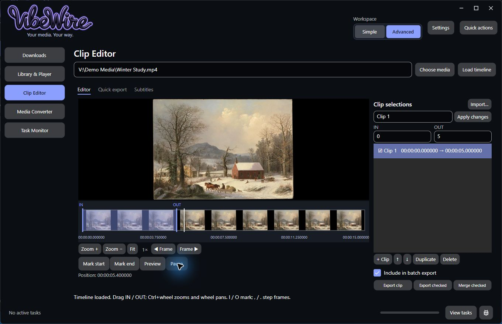
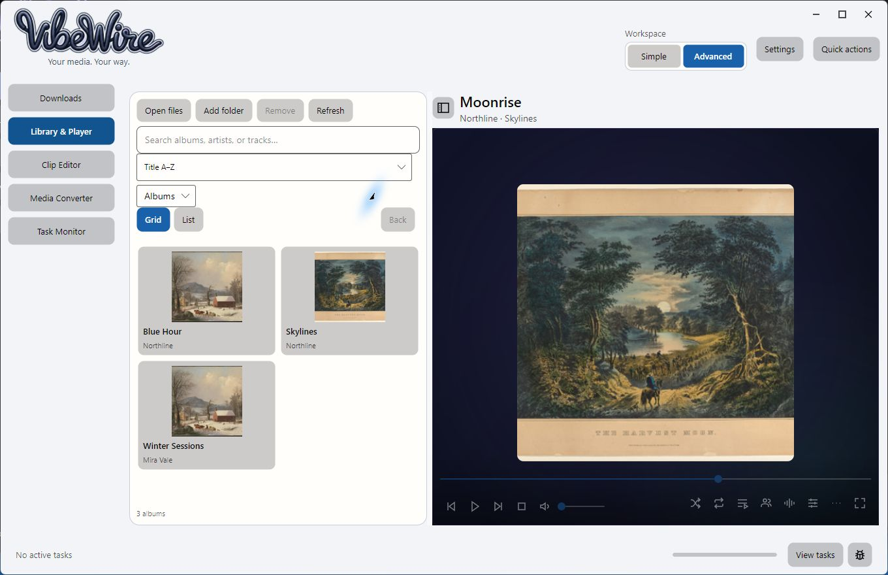
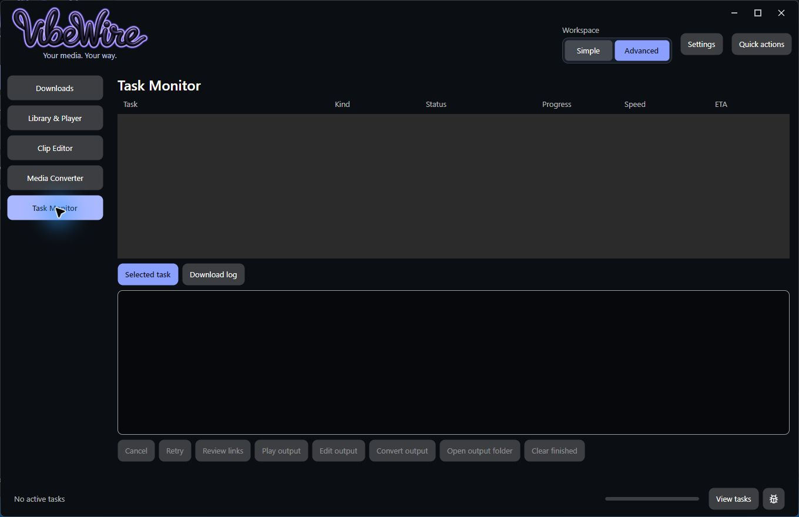

  

  <strong>Play, organize, download, and edit your media in one Windows app.</strong> 
  Free to download and use. Built with Avalonia and LibVLC.

  <a href="https://github.com/oofitsnathaniel/vibewire/releases/download/v1.2.1/VibeWire-1.2.1-windows-x64-setup.exe"><strong>Download Vibe Wire 1.2.1 for Windows x64 (.exe)</strong></a> 
  <a href="https://github.com/oofitsnathaniel/vibewire/releases/latest">Latest release</a> ·
  <a href="#screenshots">Screenshots</a> ·
  <a href="#privacy-and-security">Privacy &amp; security</a> ·
  <a href="https://github.com/oofitsnathaniel/vibewire/issues">Get help</a>

## What you can do

| Workspace | What it does |
| --- | --- |
| **Downloads** | Use Simple Mode for everyday downloads. Switch to Advanced for download previews, queues, quality and audio format choices, and subtitle options on supported sites. |
| **Library & Player** | Browse local music, video, and photos. Browse beside the player or use separate views, manage Continue Watching and Up Next, use resizable picture-in-picture, and choose music visualizers and album artwork. |
| **Clip Editor** | Trim a local video with a timeline, frame controls, and precise in/out points, then export a clip. |
| **Media Converter** | Convert supported audio, video, and image formats and inspect media files. |
| **Task Monitor** | See progress and results for background work such as downloads and conversions. |

Choose from **Dark**, **Light**, **Halloween**, and **Christmas** themes under **Settings → Appearance**. Optional metadata lookups and media tools can be configured in Settings.

## Install and update

1. [Download the Windows x64 installer](https://github.com/oofitsnathaniel/vibewire/releases/download/v1.2.1/VibeWire-1.2.1-windows-x64-setup.exe). Use the `-windows-x64-setup.exe` file from [GitHub Releases](https://github.com/oofitsnathaniel/vibewire/releases).
2. Run the installer and open Vibe Wire. The Windows package includes its .NET runtime and playback libraries. It targets Windows x64, with an installer minimum of Windows 10 build 17763.
3. Open **Settings → Integrations** to set up tools such as **yt-dlp**, **FFmpeg**, and **FFprobe** for downloads, conversion, and other tool-assisted tasks.
4. Open **Settings → Updates → Check for updates** for new releases. **Stable** is the default public feed. Invited testers can select **Private Beta** with a GitHub token from their own account.

The installer currently lacks a Windows Authenticode signature. In-app updates verify signed release metadata and check the installer against it. See [release file details](RELEASING.md#release-files) for manual verification.

## Screenshots

Captured directly from **Vibe Wire 1.1.0** on Windows using demo media in an isolated profile. Click an image to view it at full size. These are authentic application captures, including the native video preview.

| Simple Mode | Advanced Mode |
| --- | --- |
|  |  |

| Library & Player | Album browsing |
| --- | --- |
|  |  |

| Clip Editor | Media Converter |
| --- | --- |
|  |  |

<strong>Explore the themes and more screens</strong>

Dark is shown above. Choose a different look in **Settings → Appearance**.

| Light | Halloween |
| --- | --- |
|  |  |

| Christmas | Task Monitor |
| --- | --- |
|  |  |

Artwork is from the public-domain demo collection. [See artwork credits](THIRD-PARTY-NOTICES.md#artwork-and-metadata).

## Privacy and security

- **Local library.** Library paths, preferences, playback history, cached artwork, and saved metadata are stored on your device. Listening to or viewing local media does not require an account.
- **Online features are configurable.** Downloads contact the sites you choose. MusicBrainz, YouTube, and TMDB lookups use their respective services when enabled or requested. Stable update checks contact GitHub.
- **Discord sharing is optional.** Rich Presence starts off. When enabled, it shares playback titles, music credits and timing through the installed Discord desktop app. See the privacy details for what is shared.
- **Verified updates.** The app verifies the publisher’s signature on update metadata, then checks the installer size and SHA-256. Windows Authenticode signing is a separate check.
- **Bug reports are opt-in.** Use the bug icon beside **View tasks** to send a report through the project’s Google Apps Script form, or copy it for your own use. Follow-up email and technical details are optional.

[Read the privacy and security details](PRIVACY.md).

## Licensing and credits

Vibe Wire is free to download and use. This repository distributes the Windows installer and public documentation. The application source is private. Open-source components such as Avalonia, .NET, and LibVLC retain their own licenses. See [licensing, dependency notices, and artwork credits](THIRD-PARTY-NOTICES.md).

## Help and releases

- [Report a bug or ask for help](https://github.com/oofitsnathaniel/vibewire/issues). Include the app version and steps to reproduce. GitHub issues are public, so leave out access tokens, private paths, and personal details.
- [Browse release notes and installers](https://github.com/oofitsnathaniel/vibewire/releases).
- [Understand checksums, signed manifests, and versioning](RELEASING.md).

