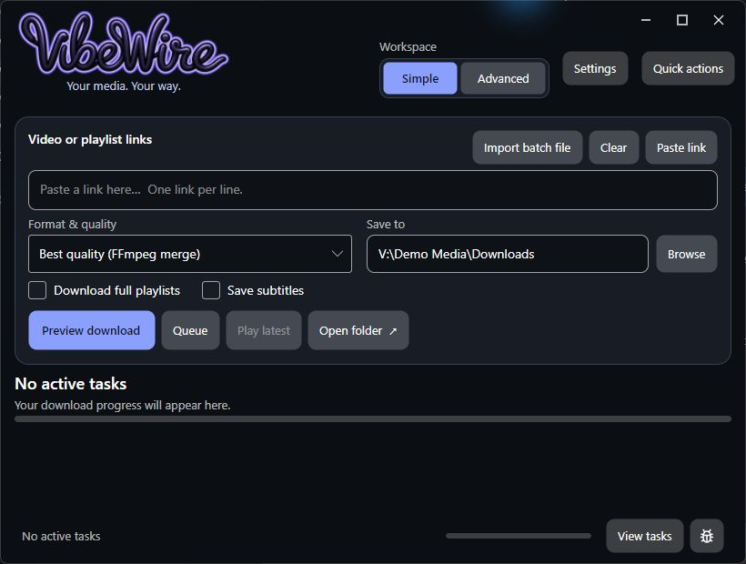
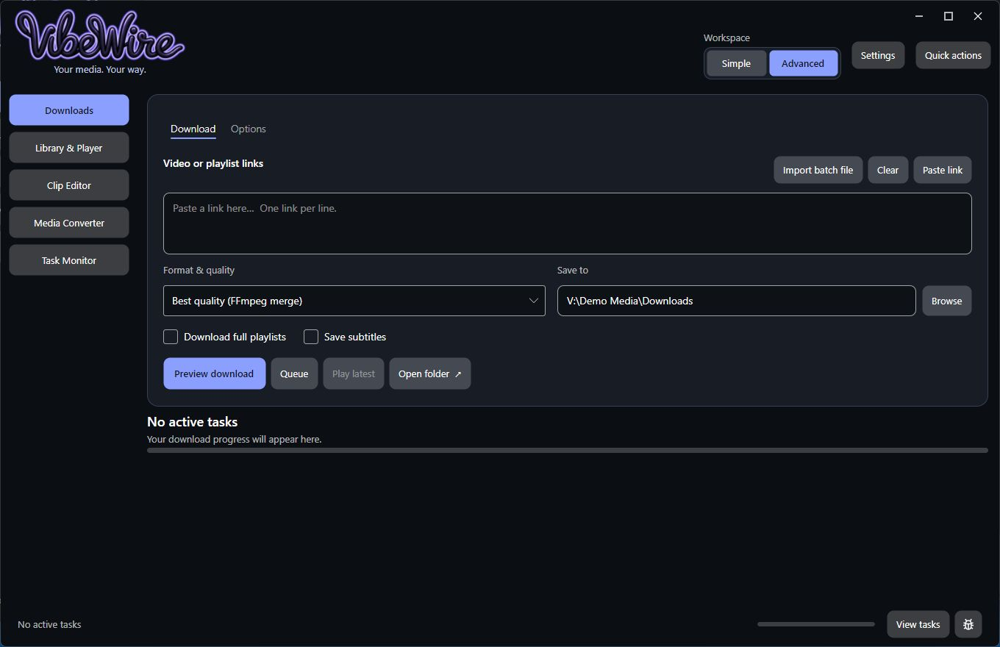
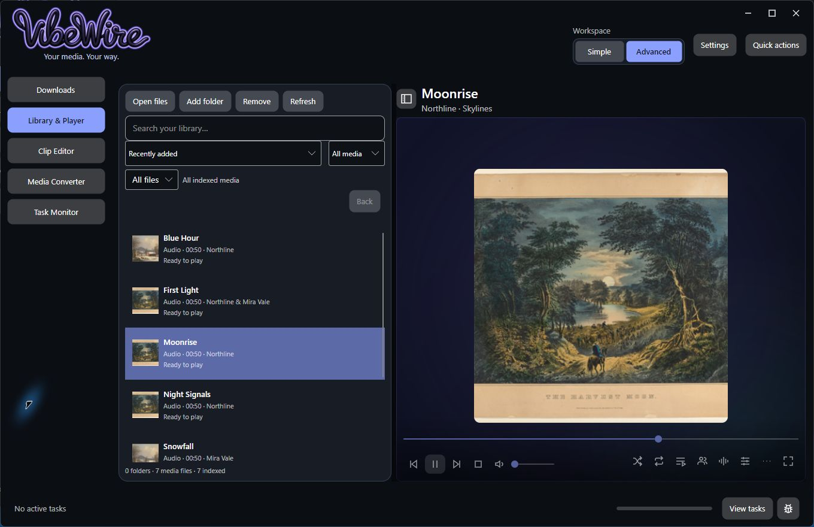
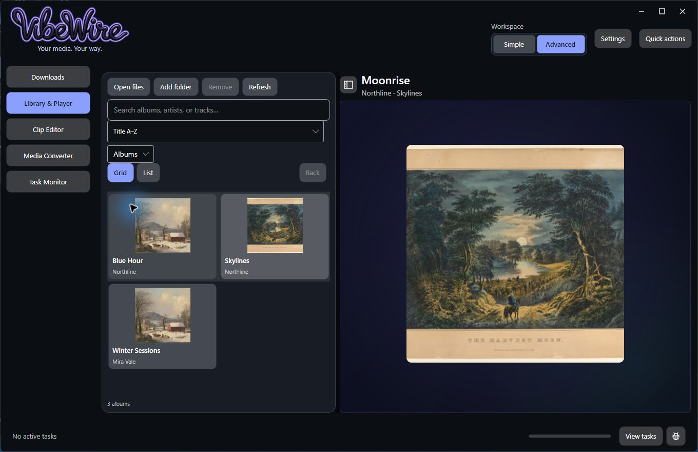
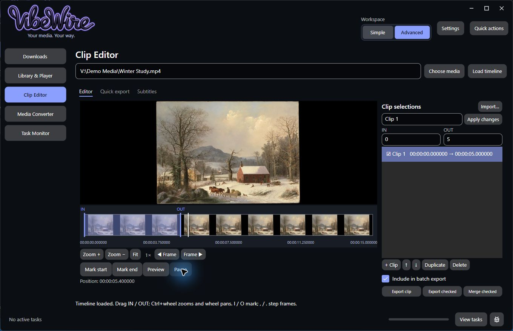
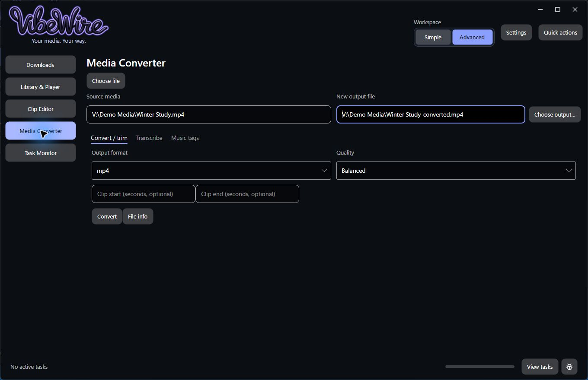
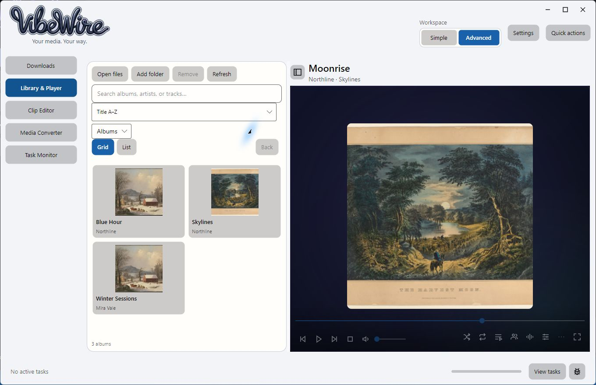
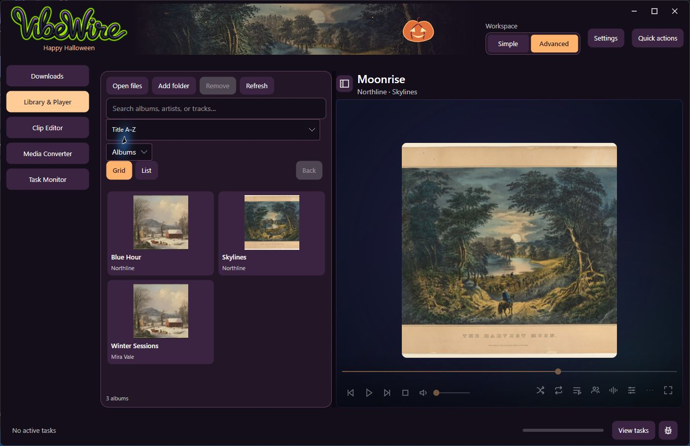
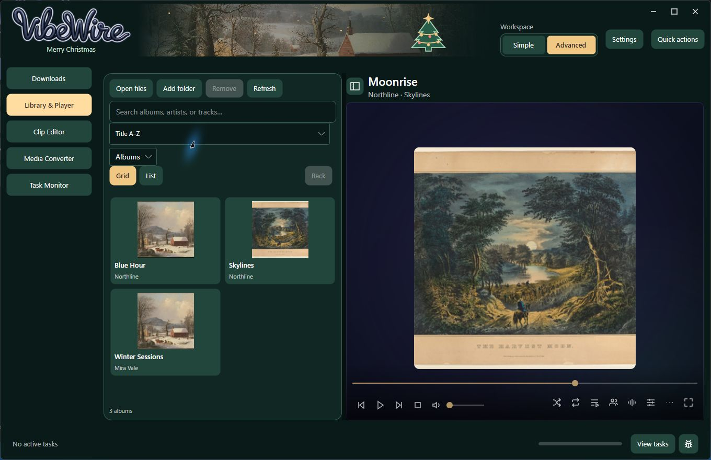
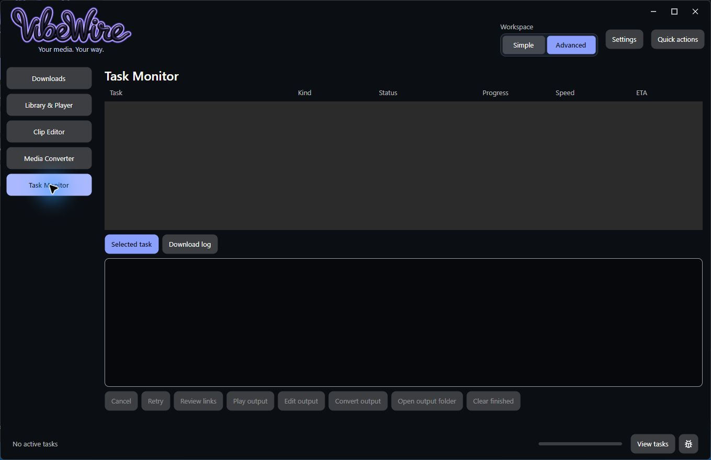

# Vibe Wire 1.1.0 screenshots

Authentic Windows captures from the released 1.1.0 application, taken with an isolated demo profile. No generated interfaces or composited player frames are used. Dark is shown in the workspace images; the seasonal screenshots show the same library with different themes.

[Back to the overview](../README.md#screenshots) · [Artwork credits](https://github.com/oofitsnathaniel/vibewire/blob/main/THIRD-PARTY-NOTICES.md#artwork-and-metadata)

## Simple Mode

## Advanced Mode

## Library & Player

## Album browsing

## Clip Editor

## Media Converter

## Light theme

## Halloween theme

## Christmas theme

## Task Monitor

